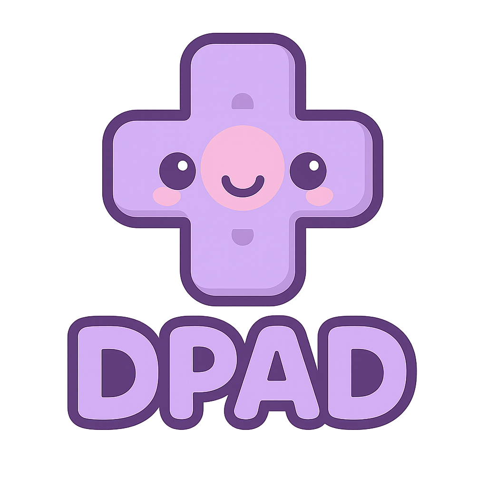

<h1 align="center">
  📺 Dpad
  <br>
  <span style="font-size: 0.6em; font-weight: normal;">D-pad navigation for Flutter TV apps</span>
</h1>

<p align="center">
  <a href="https://github.com/fluttercandies/dpad/blob/main/README_CN.md">
    
  </a>
</p>

<p align="center">
  
</p>

<p align="center">
  <a href="https://pub.dev/packages/dpad">
    
  </a>
  <a href="https://fluttercandies.github.io/dpad/">
    
  </a>
  <a href="https://github.com/fluttercandies/dpad">
    
  </a>
  <a href="https://github.com/fluttercandies/dpad/blob/main/LICENSE">
    
  </a>
</p>

<div align="center">
  <strong>Focus that behaves the way TV users expect — regions with memory, beam-based directional traversal, press feedback, and a remote that never goes dead.</strong>
</div>

<p align="center">
  <a href="https://fluttercandies.github.io/dpad/"><strong>▶ Try the live demo</strong></a>
  — the example app in your browser; arrow keys, Enter and Esc are the remote.
</p>

## Why Dpad?

Flutter's built-in directional focus picks the geometrically *closest* widget. On a real TV layout that means focus jumps lanes between the sidebar and the content, skips rows, escapes carousels, and forgets where you were. Dpad replaces that engine with the model TV platforms actually use (Android's `FocusFinder` / Leanback):

- **🗂 Regions with memory** — a sidebar, a poster row, a grid: each `DpadRegion` keeps focus inside itself first, and when you come back, you land on the item you left.
- **📐 Beam-based traversal** — candidates aligned with the focused item beat diagonal ones. Down means *down*, not "down-ish and slightly to the right".
- **🧲 Edge control per axis** — leave, stop, wrap or line-wrap at every region boundary. Carousels wrap, panels stop, grids line-wrap, everything else flows.
- **🛟 Focus never dies** — app starts with focus, pushed pages get initial focus without `autofocus`, focus survives list refreshes, dialog dismissals and app resume. A remote with nothing focused is a dead remote; Dpad makes that state unrepresentable.
- **⏯ Real remote semantics** — select & long-select with pressed-state visuals, back/menu keys, app shortcuts, key repeat — all standing down automatically while a text field is being edited.
- **⌨️ Text fields done right** — mid-text, arrows move the caret; at the caret's edge (and vertically in single-line fields) they navigate away, so a remote-only user is never trapped in a search box. IME composition owns the keys while active.
- **📜 Lazy-list aware** — when the next item isn't built yet (`ListView.builder`), Dpad scrolls and continues instead of stopping at the cache boundary.
- **🖱 Hybrid input** — taps and mouse clicks work out of the box for touch TVs and desktop debugging.
- **🔍 Built-in focus inspector** — `debugOverlay: true` outlines the focused node with its label, region and size. Focus bugs on TV are invisible without it.

Everything is built on Flutter's own focus system (`FocusTraversalPolicy`, `Shortcuts`, `Actions`) — no key hijacking, full interop with plain `Focus` widgets, `TextField`s, and dialogs.

## Quick start

### 1. Add the dependency

```yaml
dependencies:
  dpad: ^3.3.0
```

### 2. Install the root (one line)

```dart
import 'package:dpad/dpad.dart';

MaterialApp(
  builder: Dpad.wrap(),   // covers every route, dialog and sheet
  home: const HomePage(),
)
```

### 3. Make things focusable

```dart
DpadFocusable(
  autofocus: true,
  onSelect: () => playMovie(movie),
  child: PosterCard(movie),
)
```

That's a working TV app: arrow keys / remote d-pad move focus with a scale-and-border effect (themable), center button calls `onSelect`, and the focused item auto-scrolls into view with padding for its glow.

## Regions: structure your screen like a TV app

```dart
Row(
  children: [
    // Sidebar: never lets focus fall off the top/bottom of the screen,
    // remembers the selected destination.
    DpadRegion(
      verticalEdge: DpadEdgeBehavior.stop,
      child: SidebarColumn(...),
    ),
    Expanded(
      child: ListView(
        children: [
          for (final row in rows)
            // Each poster row remembers its position. Down and back up
            // returns to the same poster — like every real TV app.
            DpadRegion(
              child: SizedBox(
                height: 200,
                child: ListView(scrollDirection: Axis.horizontal,
                    children: row.cards),
              ),
            ),
        ],
      ),
    ),
  ],
)
```

### Entering a region

`DpadRegion(enter: ...)` decides where focus lands when it crosses in:

| `DpadEnterBehavior` | Landing item |
|---|---|
| `restore` *(default)* | The last focused item; falls back to the position-nearest item, the `entry` item, then the geometric target |
| `entry` | The item marked `DpadFocusable(entry: true)` |
| `nearest` | The geometrically nearest item (plain Flutter behavior) |

### Leaving a region

Each direction independently chooses what happens at the boundary — set the
axis-wide `horizontalEdge` / `verticalEdge`, then override any single side
with `leftEdge` / `rightEdge` / `upEdge` / `downEdge`:

| `DpadEdgeBehavior` | Effect |
|---|---|
| `leave` *(default)* | Focus continues to the best target outside |
| `stop` | Key is consumed, focus stays, `onEdge` fires (bump animations, sounds) |
| `wrap` | Focus wraps to the opposite side — carousels |
| `lineWrap` | Focus steps to the next grid line: right past a row ends on the first cell of the row below (and back); at the grid's first/last line `onEdge` fires. Lazy grids scroll to reveal the next line. |

```dart
DpadRegion(
  horizontalEdge: DpadEdgeBehavior.wrap,   // an endless episode carousel
  onEdge: (direction) => playBumpSound(),
  onFocusChange: (inside) => setState(() => highlighted = inside),
  child: episodeRow,
)

// A grid: line-wrap rows, and never escape sideways.
DpadRegion(
  horizontalEdge: DpadEdgeBehavior.lineWrap,
  child: settingsGrid,
)

// A row that stops at its end but still lets users reach the nav rail.
DpadRegion(
  horizontalEdge: DpadEdgeBehavior.stop,
  leftEdge: DpadEdgeBehavior.leave,        // only the rail stays reachable
  child: row,
)
```

Direction names are *physical* — they name the remote's keys — so they mean
the same thing in RTL layouts. Reading-order-aware behavior (grid line wrap,
initial focus placement) resolves RTL automatically.

### Memory that survives rebuilds

State-based memory dies when a section switcher rebuilds its subtree — the
classic "tabs forget where I was" TV pitfall. Give the region a stable key
and the memory persists, position-aware, across any rebuild:

```dart
DpadRegion(
  memoryKey: 'home/trending-row',
  child: trendingRow,
)
```

## Focus effects

Effects are immutable, const-able, and composable — first effect in the list is the outermost wrapper:

```dart
DpadFocusable(
  effects: const [
    DpadScaleEffect(scale: 1.1),                // lift…
    DpadGlowEffect(color: Colors.amber),        // …and glow
  ],
  child: card,
)
```

Built-ins: `DpadScaleEffect` (with pressed-state push-down), `DpadBorderEffect` (layout-shift-free), `DpadGlowEffect`, `DpadElevationEffect`, `DpadOpacityEffect` (dim the rest), `DpadTintEffect`, `DpadCustomEffect`.

Set app-wide defaults once:

```dart
MaterialApp(
  builder: Dpad.wrap(
    theme: const DpadThemeData(
      effects: [DpadGlowEffect()],
      scrollPadding: 64,
    ),
  ),
  home: const HomePage(),
)
```

Or take full control — including the **pressed** state of the select key:

```dart
DpadFocusable(
  onSelect: play,
  builder: (context, state, child) => AnimatedScale(
    scale: state.pressed ? 0.97 : (state.focused ? 1.06 : 1.0),
    duration: const Duration(milliseconds: 120),
    child: child,
  ),
  child: card,
)
```

## Flying highlight

Per-item effects decorate items *in place*. For the continuous look of
mainstream TV and game interfaces — one highlight that physically slides from
item A to item B — turn on the flying highlight:

```dart
MaterialApp(
  builder: Dpad.wrap(
    highlight: const DpadHighlight(),   // ring by default, 220ms flights
  ),
  home: const HomePage(),
)
```

While it is on, pair per-item effects with a simple lift (the highlight
carries the outline):

```dart
theme: const DpadThemeData(effects: [DpadScaleEffect()]),
```

The flight follows the focused item through scrolls, route transitions and
scale animations, chains smoothly when keys are pressed faster than flights
finish, fades in place on first appearance and fades out when focus is lost.
A blocked move (last item of a row, bottom of a list) bounces the highlight
off the edge when you set `nudgeOffset`.

**It follows shapes, too.** The highlight reads each item's own silhouette
(`ClipRRect`, a `BoxDecoration` corner radius or circle, `ClipOval`, physical
models) and morphs its corner radius between them mid-flight — a 12-pixel
poster grows into a circular avatar's full rounding as the highlight flies
there (the example's Library grid demonstrates it). The rounded effects
(ring, spotlight, vignette, glow) follow the shape by default
(`followShape: true`, an explicit switch); pass an explicit `borderRadius`
to pin it. Shape data lives somewhere else? Mix your own table with the
shipped detection via `DpadHighlight.radiusOf(node)`.

**One configuration type, three placement points** — resolved for wherever
focus lands, nearest first:

```dart
Dpad(
  highlight: const DpadHighlight(), // app-wide default
  child: app,
)

DpadHighlightTheme(                           // a page or section
  data: const DpadHighlight(
    effects: [DpadHighlightBracketsEffect()], // the game reticle look
  ),
  child: characterGrid,
)

DpadFocusable(                                // a single item
  highlight: DpadHighlight.none,              // …or opt the item out
  child: customPaintedButton,
)
```

**Looks are composable effects** — motion knobs live on `DpadHighlight`
(`duration`, `curve`, `padding`, `appearDuration`, `nudgeOffset`), looks on
the effect list. Try `curve: Curves.easeOutBack` for a springy flight.
Built-ins: `DpadHighlightRingEffect` (tvOS ring), `DpadHighlightGlowEffect`,
`DpadHighlightSpotlightEffect` (translucent fill),
`DpadHighlightBracketsEffect` (game HUD corners),
`DpadHighlightVignetteEffect` (dims everything outside the item), and
`DpadHighlightCustomEffect` for anything else.

**The escape hatch is a real API**: subclass `DpadHighlightEffect` or use the
custom effect — both receive the live `DpadHighlightState` every frame: the
interpolating `rect` and `radius`, the tracked `node`, the flight's timeline
(`fromNode`, `t`), plus `pressed` and `visible`. That is everything needed to
interpolate values the engine does not — colors, shadows, private shape
tables:

```dart
DpadHighlightCustomEffect((context, state) {
  final Color color = Color.lerp(
    posterColorOf(state.fromNode ?? state.node),
    posterColorOf(state.node),
    state.t,
  )!;
  return state.positioned(MyFocusHalo(color: color, radius: state.radius));
})
```

## Remote interactions

```dart
DpadFocusable(
  onSelect: () => play(),                 // center button (or tap)
  onLongSelect: () => showOptionsSheet(), // held center button
  onFocusChange: (focused) => setState(() => hovered = focused),
  onDirection: (direction) {              // sliders: consume left/right
    if (direction == TraversalDirection.right) { volumeUp(); return true; }
    if (direction == TraversalDirection.left)  { volumeDown(); return true; }
    return false;                         // up/down keep navigating
  },
  child: volumeRow,
)
```

Back, menu, app-level shortcuts, sound feedback and the focus inspector
live on the root:

```dart
Dpad.wrap(
  onBack: () {                  // back key: pop, or confirm exit at home
    if (navigator.canPop()) { navigator.pop(); return true; }
    showExitDialog(); return true;
  },
  onMenu: () => showAboutDialog(),
  onFocusChange: (node) {       // the app-wide focus "tick" sound
    if (node != null) audio.playTick();
  },
  onBlockedMove: (direction) {  // focus stayed put: an edge was hit
    audio.playEdgeTick();       // (or haptics, or a "no more items" toast)
  },
  shortcuts: {
    LogicalKeyboardKey.keyS: () => openSearch(),
  },
  debugOverlay: kDebugMode,     // on-screen focus inspector
)
```

A *blocked move* is a directional press that could not move focus — nothing
to land on (the last item of a row), or a region boundary that consumed it
(`stop`, a `wrap`/`lineWrap` with nowhere left to go). The same presses also
bounce the flying highlight (see `DpadHighlight.nudgeOffset`), and regions
report their own edges through `DpadRegion.onEdge` — wire feedback at
exactly one of the layers, or the edge sound plays twice. One exception: a
boundary discovered by a lazy-load scroll retry (the engine scrolled,
nothing new appeared) reports through `DpadRegion.onEdge` only — the press
already returned by then.

All of these — and directional navigation itself — automatically stand down while a `TextField` is focused, so typing is never hijacked.

Unusual remote? Remap any key group:

```dart
Dpad.wrap(
  keySet: const DpadKeySet().copyWith(
    select: [LogicalKeyboardKey.f1, ...DpadKeySet.defaultSelect],
  ),
)
```

### Game controllers

On Android (including Android TV and Fire TV), paired game controllers work
out of the box: the d-pad reports as arrow keys and the `A`/`B` buttons are
already mapped to select/back in the default `DpadKeySet`. Buttons like
`gameButtonX`, `gameButtonY` and the shoulders arrive as
`LogicalKeyboardKey`s too — map them as extra select keys via `copyWith`, or
as actions via `Dpad.shortcuts`.

Two things a controller can do that no key remap can reach:

* **Analog sticks** report as axis motion events, not key events, and
  Flutter does not synthesize keys from them. Read them with a gamepad plugin
  and drive navigation programmatically — `DpadController` exists exactly for
  input sources that are not keyboards:

  ```dart
  gamepads.events?.listen((event) {
    final dpad = Dpad.of(navigatorContext);
    switch (event.key) {
      case GamepadButton.dpadUp:    dpad.moveUp();
      case GamepadButton.dpadDown:  dpad.moveDown();
      case GamepadButton.dpadLeft:  dpad.moveLeft();
      case GamepadButton.dpadRight: dpad.moveRight();
      default: break;
    }
  });
  ```

* **Web and desktop** never deliver gamepad input as keyboard events, so
  controllers need the same plugin glue there (browsers expose gamepads only
  through the Gamepad API; macOS/Windows treat them as HID gamepads).
  Desktop mappers like Steam Input or JoyToKey also work — they synthesize
  real key events, which the default key set already speaks.

## Programmatic control

```dart
final dpad = Dpad.of(context);

dpad.moveDown();                 // exactly like a remote key press
dpad.move(TraversalDirection.left);
dpad.select();                   // press the focused item (with the
                                 // pressed-state pulse a real key gives)
dpad.requestFocus(searchNode);   // jump focus (updates region memory)
dpad.ensureVisible();            // padded scroll-into-view
dpad.ensureVisible(alignment: DpadRevealAlignment.center);
dpad.focused;                    // the currently focused node
```

## Best practices for TV

Distilled from the example app — follow these and a complex TV app stays
predictable:

1. **One `autofocus` per screen.** Give the primary action (`Play`, first
   card) `autofocus: true`. Everything else is handled: pushed routes,
   removed items and app resume keep focus alive automatically.
2. **One `DpadRegion` per visual section.** Sidebar, each shelf row, each
   grid. Region-first traversal and focus memory are what make navigation
   feel native.
3. **Use `memoryKey` on regions inside section switchers.** Plain state
   dies with the subtree; keyed memory survives any rebuild.
4. **Lay out shelves with the padding *inside* the scroll view.**

   ```dart
   SizedBox(
     height: cardHeight + 32,                    // headroom for effects
     child: ListView.builder(
       scrollDirection: Axis.horizontal,
       padding: const EdgeInsets.symmetric(horizontal: 36, vertical: 16),
       ...
     ),
   )
   ```

   Scaled and glowing focus effects paint into the padding instead of
   being clipped at the row edge.
5. **`stop` the edges of anchored panels, `wrap` carousels.** A sidebar
   should never let focus fall off the screen; an episode strip can loop.
6. **Wire actions through `onSelect`, not the child's `onPressed`.**
   `DpadFocusable` is the single focus stop; a wrapped Material button is
   just visuals — and for screen readers too: either wire the button's
   `onPressed` to the same behavior, or wrap it in `ExcludeSemantics` and
   give the item a `semanticLabel` so the wrapper is the single semantics
   node.
7. **Don't fight text fields.** Leave `TextField`s bare (not wrapped in
   `DpadFocusable`); arrows edit text mid-string and navigate away at the
   edges automatically.
8. **Debug with `debugOverlay: true`.** Focus bugs are invisible on a TV
   across the room; the inspector shows the focused node, its region and
   geometry live.
9. **Center row reveals for the theater feel.** The default reveal shows
   the focused item with just enough padding; `scrollAlignment:
   DpadRevealAlignment.center` (on the theme, an item, or
   `ensureVisible`) keeps every focused poster mid-viewport instead —
   the Netflix-style row glide.

## Accessibility

* **Screen readers work out of the box.** Every self-contained
  `DpadFocusable` (the default) announces as a button; assistive activation
  (TalkBack's double-tap, VoiceOver's default action) fires `onSelect`, and
  a long-press fires `onLongSelect` — as long as the child does not expose
  its own button/tap semantics: an interactive child keeps its node and
  activation, so the reader reaches the child's callback first (see
  best practice 6). Give image-only items a spoken name with
  `semanticLabel`:

  ```dart
  DpadFocusable(
    semanticLabel: movie.title,   // announced ahead of the artwork
    onSelect: () => play(movie),
    child: PosterArt(movie),
  )
  ```

* **Reduced motion is respected.** When the platform's
  "remove animations" accessibility setting is on
  (`MediaQuery.disableAnimations`), highlight flights land instantly,
  appear/fade cuts are immediate, the edge bounce stands down, and
  auto-scrolls jump instead of animating.

## Shipping checklist

The last mile before submitting to a TV store — items 1–2 are Android
TV/Fire TV store requirements, the rest are quality gates:

1. **Banner.** Android TV requires a `android:banner` drawable in the
   manifest, or the store listing shows a gray placeholder.
2. **Leanback launcher intent.** Declare
   `<category android:name="android.intent.category.LEANBACK_LAUNCHER" />`
   on the main activity, and set `android.software.leanback` as a
   required-feature only if the phone build is separate.
3. **Overscan-safe layout.** TVs chop off ~5% at the screen edges.
   Keep focus indicators and text inside `SafeArea` (or explicit margins);
   full-bleed art can stay full-bleed.
4. **Test on a real D-pad.** Keyboard arrows approximate remotes well,
   but hold-repeat rate, SELECT latency and BACK behavior differ — run the
   app on a TV or emulator before shipping.
5. **Keyboard and touch too.** TVs get browsers, mirrors and companion
   screens: `tapToSelect` (default on) covers touch, `DpadKeySet.copyWith`
   covers keyboard-first users.
6. **Turn the animations off once.** Flip the system's "remove animations"
   setting and walk the app — with this package everything lands instantly
   and nothing lags behind focus.

## How it plays with Flutter

- `DpadTraversalPolicy` is a `FocusTraversalPolicy` — plain `Focus`/`ElevatedButton` widgets participate in navigation, dialogs trap focus through their own `FocusScope`, and popping a route restores focus to the item that opened it, all natively.
- `DpadFocusable` excludes its child's focus by default (`excludeChildFocus: true`) so wrapping a button never creates two d-pad stops. Set it to `false` when the child must own focus (e.g. a `TextField`).
- Tab order falls back to reading order.

## Example

The [example](https://github.com/fluttercandies/dpad/tree/main/example) is a complete TV streaming UI — expanding sidebar, poster rows with memory, wrap-around episode carousel, search with text input, settings with an `onDirection` volume slider, long-select context sheets, and an exit-confirmation back flow. Run it on a TV emulator or any desktop:

```bash
cd example
flutter run -d macos   # or windows, linux, an Android TV emulator…
```

> Developing **in this repository** (running the example or the in-repo
> tests) needs Flutter 3.32 or newer — the example's dev tooling only
> resolves there. The published package keeps the 3.19 floor; consumers
> are unaffected.

## Platform support

| Platform | Input |
|---|---|
| Android TV / Google TV | Remote d-pad, game controllers |
| Amazon Fire TV | Fire TV remotes |
| Apple TV (via web/custom embedder) | Siri Remote arrows |
| Desktop (macOS/Windows/Linux) | Arrow keys — ideal for development |
| Web | Arrow keys (Dpad maps them even where Flutter doesn't) |

Requires Flutter `>= 3.19`.

## Migrating from 2.x

3.0 is a ground-up rewrite with a smaller, TV-first API. The old global history stack, rule tables and registration flags are replaced by declarative widgets:

| 2.x | 3.0 |
|---|---|
| `DpadNavigator(child: app)` | `MaterialApp(builder: Dpad.wrap())` |
| `Dpad.navigateUp(context)` | `Dpad.of(context).moveUp()` |
| `DpadFocusable(builder: (c, focused, child) ...)` | `builder: (c, state, child)` with `state.focused` / `state.pressed` |
| `FocusEffects.glow()` (closures) | `effects: const [DpadGlowEffect()]` (const classes) |
| `FocusMemoryOptions` + history stack | per-`DpadRegion` memory (`enter: DpadEnterBehavior.restore`, the default) |
| `RegionNavigationOptions` + `RegionNavigationRule` tables | `DpadRegion(enter: ..., horizontalEdge: ..., verticalEdge: ...)` |
| `DpadFocusable(region: 'tabs', isEntryPoint: true)` | wrap the tabs in a `DpadRegion`, mark one item `entry: true` |
| `customShortcuts:` | `shortcuts:` (now suspended during text editing) |
| `onBackPressed` / `onMenuPressed` | `onBack` (returns `bool`) / `onMenu` |

See the [CHANGELOG](https://github.com/fluttercandies/dpad/blob/main/CHANGELOG.md) for the full list.

## ❤️ Support

- 🌟 [Star on GitHub](https://github.com/fluttercandies/dpad)
- 👍 [Like on pub.dev](https://pub.dev/packages/dpad)
- 🐛 [Report issues](https://github.com/fluttercandies/dpad/issues)

---

**Make Flutter shine on the big screen!** 🚀📺✨
